# 界面图库 · UI Gallery

[返回 README（中文）](../README.md) | [English README](../README_en.md)

本图库收录 TOTP 验证码工具的全部界面截图：浏览器扩展（Chrome/Edge/Firefox，MV3）与 Tauri 桌面程序共用同一套 Material Design 3 界面。

This gallery collects every UI screen of the TOTP code tool: the browser extension (Chrome/Edge/Firefox, MV3) and the Tauri desktop app share one Material Design 3 interface.

**采集方式**｜桌面端为 debug 版真机应用（真 WebView2，原生像素截图，非 DOM 仿绘）；扩展端为真 Chromium 加载真扩展后截取。界面中的账户、密钥、验证码均为随机生成的演示数据，不对应任何真实账户。

**How it was captured** | Desktop shots come from a real debug build (real WebView2, native pixel capture rather than a DOM re-render); extension shots come from real Chromium with the real unpacked extension loaded. All accounts, secrets and codes shown are randomly generated demo data tied to no real account.

---

## 目录 · Overview

### 桌面端 · Desktop

| | |
| :---: | :---: |
| [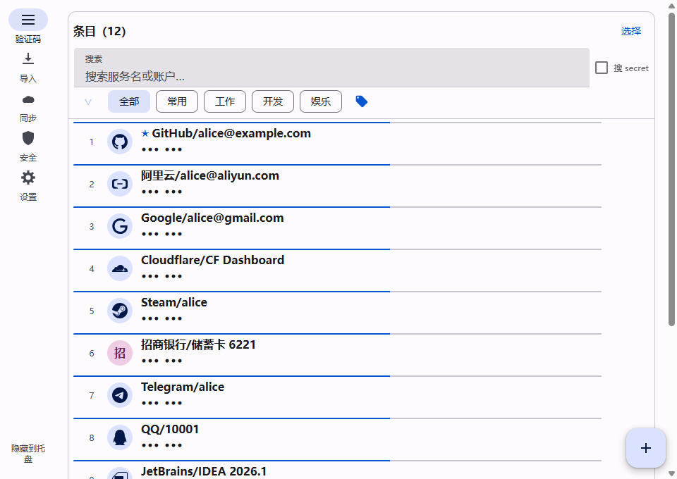](gallery/01-desktop-codes.png) **01** 验证码页（默认打码） Codes page (masked) | [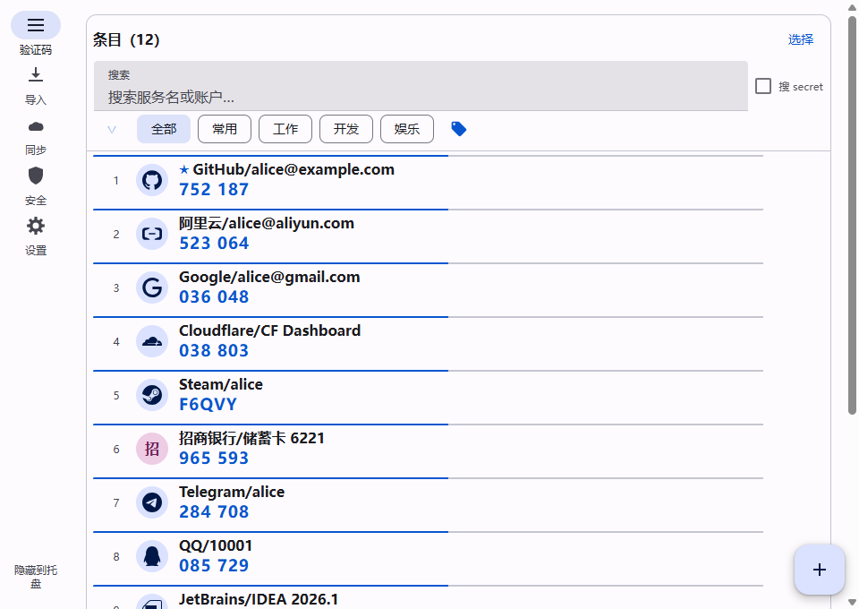](gallery/02-desktop-codes-revealed.png) **02** 验证码页（展开明文） Codes page (revealed) |
| [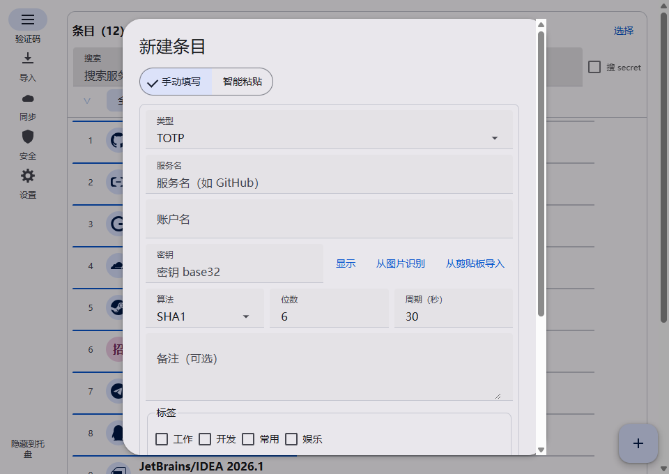](gallery/03-desktop-add-entry.png) **03** 新增条目对话框 Add-entry dialog | [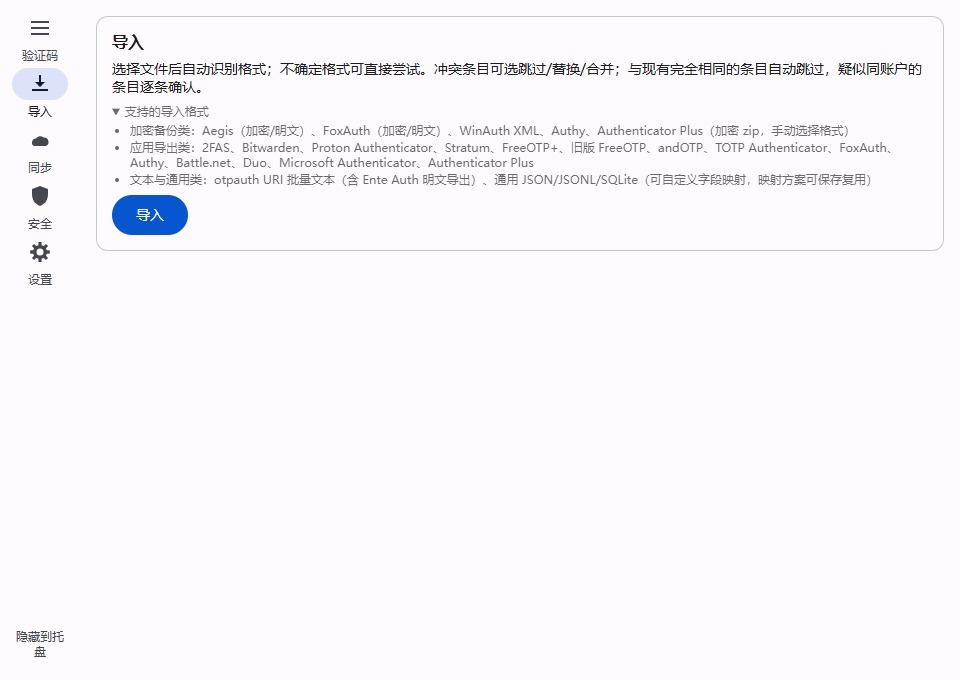](gallery/04-desktop-import.png) **04** 导入页（格式清单） Import page |
| [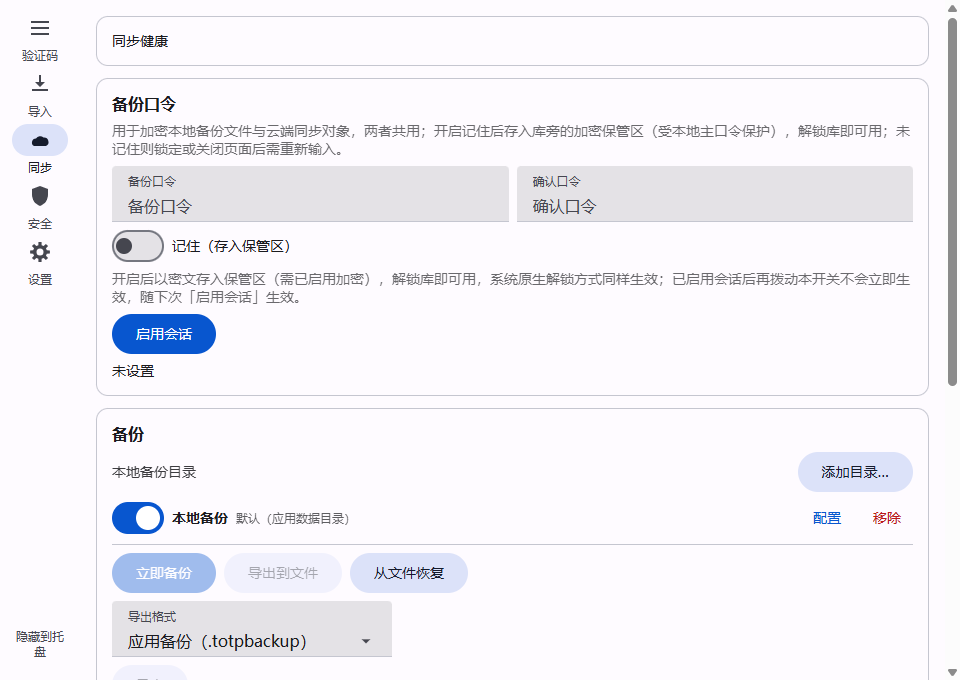](gallery/05-desktop-sync.png) **05** 同步页 Sync page | [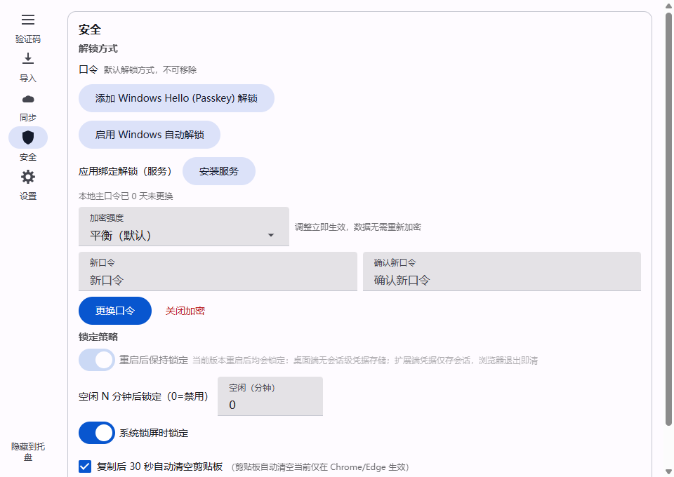](gallery/06-desktop-security.png) **06** 安全页 Security page |
| [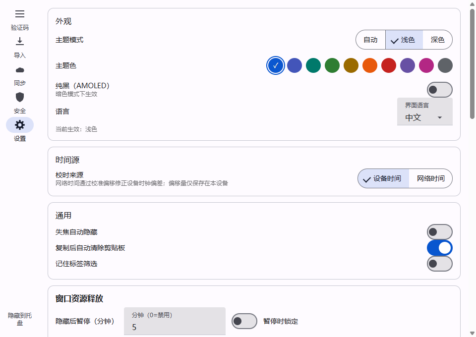](gallery/07-desktop-settings.png) **07** 设置页 Settings page | [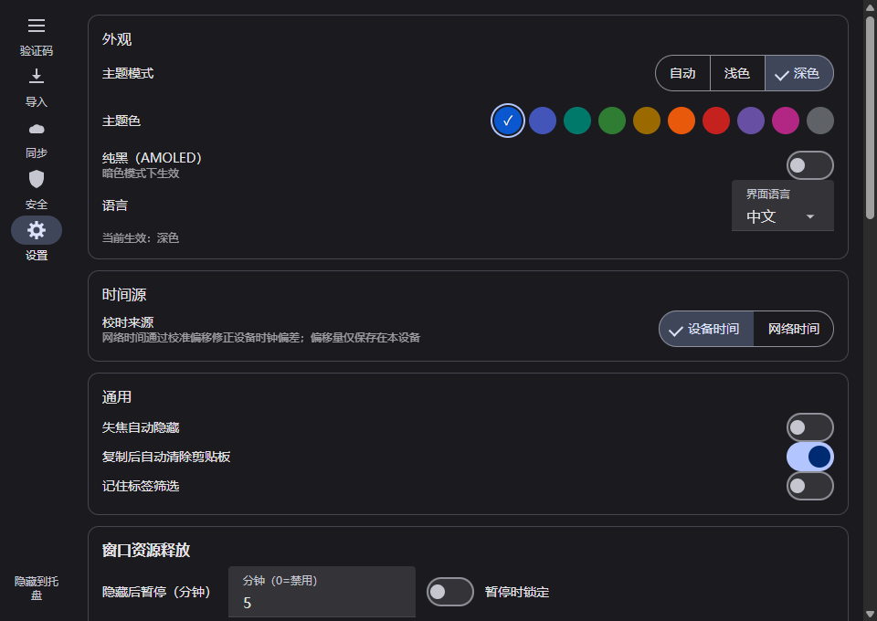](gallery/08-desktop-settings-dark.png) **08** 设置页（深色） Settings (dark) |
| [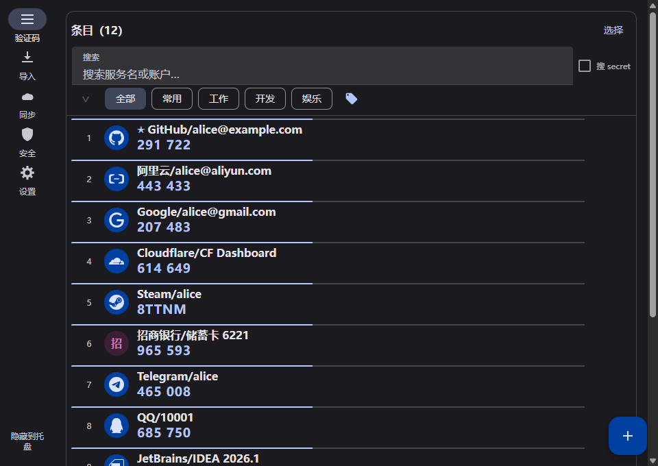](gallery/09-desktop-codes-dark.png) **09** 验证码页（深色） Codes page (dark) | [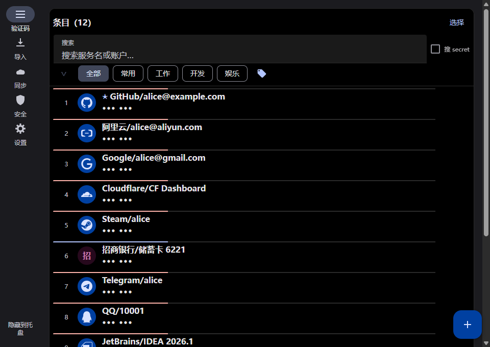](gallery/10-desktop-codes-amoled.png) **10** 验证码页（纯黑档） Codes page (AMOLED) |
| [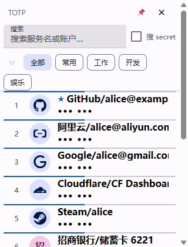](gallery/11-desktop-mini.png) **11** mini 快速窗 Mini popup | [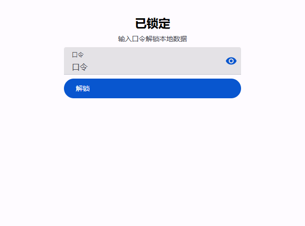](gallery/12-desktop-lock.png) **12** 锁定页 Lock screen |

### 浏览器扩展 · Browser Extension

| | |
| :---: | :---: |
| [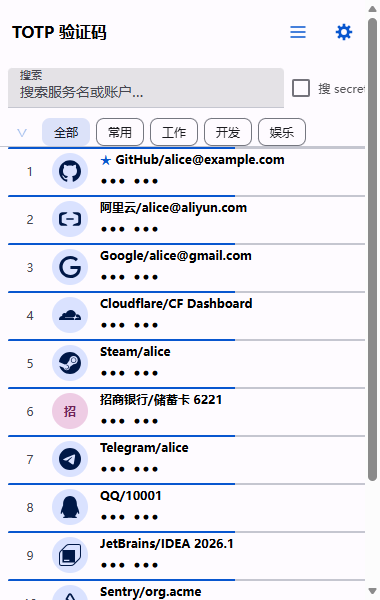](gallery/13-extension-popup.png) **13** popup 弹窗（默认打码） Popup (masked) | [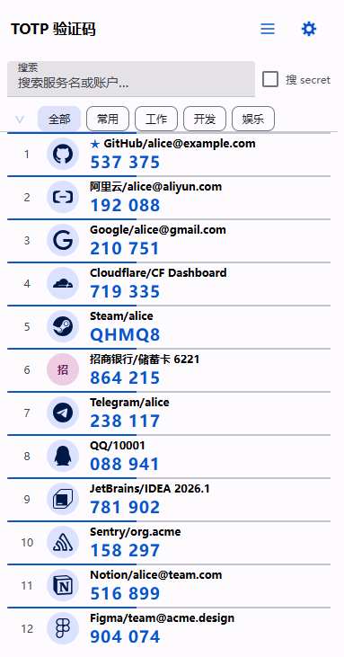](gallery/14-extension-popup-revealed.png) **14** popup 弹窗（展开明文） Popup (revealed) |
| [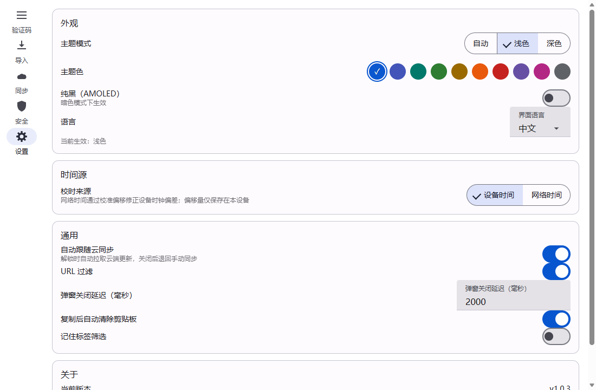](gallery/15-extension-options-settings.png) **15** options 设置页 Options · Settings | [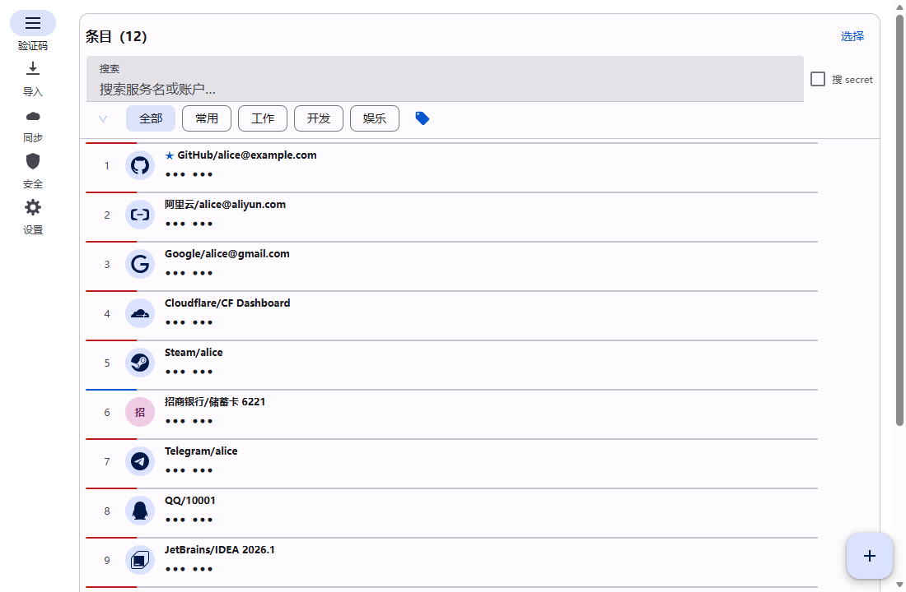](gallery/16-extension-options-codes.png) **16** options 验证码页 Options · Codes |
| [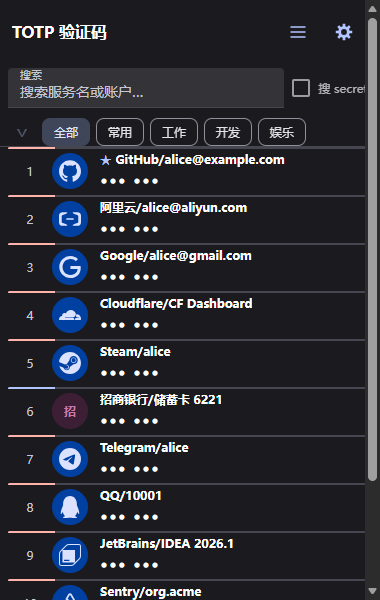](gallery/17-extension-popup-dark.png) **17** popup 弹窗（深色） Popup (dark) | [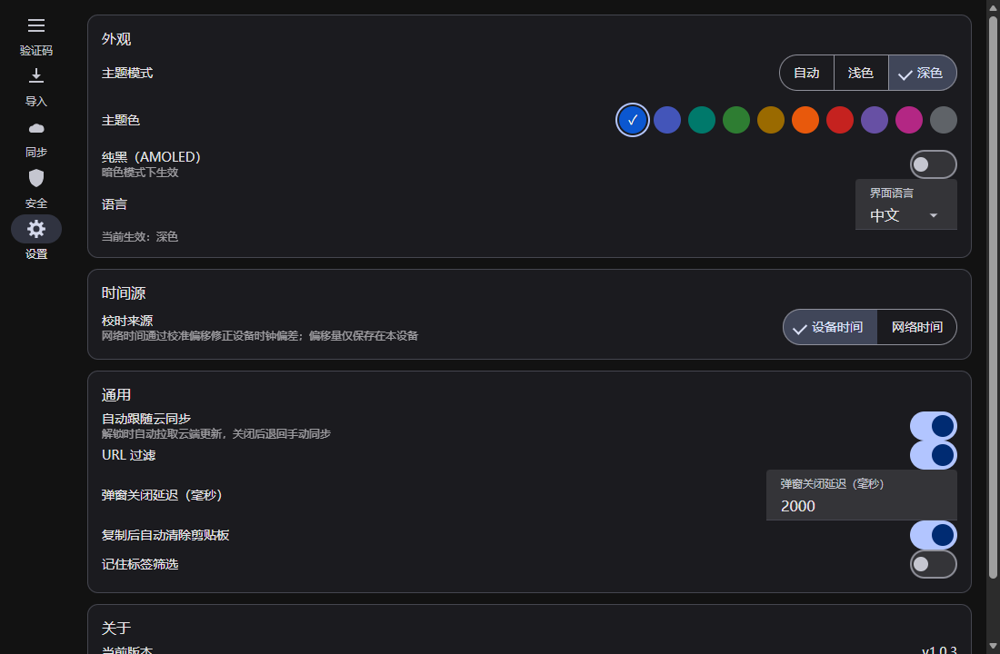](gallery/18-extension-options-dark.png) **18** options 设置页（深色） Options · Settings (dark) |

---

## 桌面端 · Desktop

### 01 · 验证码页（默认打码） / Codes page (masked by default)

中文：主界面。左侧导航为「验证码 / 导入 / 同步 / 安全 / 设置」五页；顶部搜索可按服务名或账户名过滤（勾选「搜 secret」连密钥一起搜），下方标签 chips 按「工作 / 开发 / 常用 / 娱乐」筛选；条目带服务图标、置顶星标与倒计时进度条，6 位码默认打码显示，右下悬浮按钮新增条目。

English: The main window. The left rail carries the five pages — Codes / Import / Sync / Security / Settings. The search box filters by service or account name (tick "搜 secret" to include secrets), and the tag chips filter by 工作 / 开发 / 常用 / 娱乐. Entries show a service icon, a pin star and a countdown progress bar; 6-digit codes are masked by default, and the floating action button adds a new entry.

### 02 · 验证码页（展开明文） / Codes page (revealed)

中文：双击任一条目即展开明文验证码（8 秒后自动打回），条目底部的进度线表示当前 30 秒周期剩余时间，周期末三分之一转为醒目色提示即将过期。HOTP 条目按计数取码、不过期；Steam 条目为 5 位字母码。

English: Double-click an entry to reveal its code in plain text (it re-masks after 8 seconds). The progress line under each entry shows the remaining time in the current 30-second period and turns accent-coloured in the last third, warning that the code is about to expire. HOTP entries are counter-based and never expire; Steam entries are 5-character alphanumeric codes.

### 03 · 新增条目对话框 / Add-entry dialog

中文：新增条目有「手动填写 / 智能粘贴」两种入口。手动填写可选类型（TOTP / HOTP / Steam / Yandex）、服务名、账户名与 base32 密钥；密钥行提供「显示」「从图片识别」（解码 otpauth 二维码）「从剪贴板导入」三条辅助通道；下方是算法（SHA1 / SHA256 / SHA512）、位数（5–8）、周期（秒）、备注与标签勾选。

English: New entries can be typed manually or pasted. The manual form picks a type (TOTP / HOTP / Steam / Yandex), a service name, an account name and a base32 secret; the secret row offers "show", "scan from image" (decodes an otpauth QR code) and "import from clipboard". Below sit algorithm (SHA1 / SHA256 / SHA512), digit count (5–8), period in seconds, a note field and tag checkboxes.

### 04 · 导入页（17+ 格式清单） / Import page (17+ formats)

中文：选文件后自动识别格式，不确定格式可直接尝试；冲突条目可选跳过 / 替换 / 合并，与现有完全相同的条目自动跳过，疑似同账户的条目逐条确认。展开的清单覆盖加密备份类（Aegis 加密/明文、FoxAuth、WinAuth XML、Authy、Authenticator Plus）、应用导出类（2FAS、Bitwarden、Proton Authenticator、Stratum、FreeOTP+、旧版 FreeOTP、andOTP、TOTP Authenticator、FoxAuth、Authy、Battle.net、Duo、Microsoft Authenticator、Authenticator Plus）与文本/通用类（otpauth URI、批量子文件含 Ente Auth 明文变体、通用 JSON/JSONL/SQLite）。

English: Pick a file and the format is detected automatically — if unsure, just try it. Conflicts can be skipped, replaced or merged; entries identical to existing ones are skipped automatically, and entries that look like the same account are confirmed one by one. The expanded list covers encrypted backups (Aegis encrypted/plain, FoxAuth, WinAuth XML, Authy, Authenticator Plus), app exports (2FAS, Bitwarden, Proton Authenticator, Stratum, FreeOTP+, legacy FreeOTP, andOTP, TOTP Authenticator, FoxAuth, Authy, Battle.net, Duo, Microsoft Authenticator, Authenticator Plus) and text/generic files (otpauth URIs, batch files including the plain Ente Auth variant, generic JSON/JSONL/SQLite).

### 05 · 同步页（备份与云同步） / Sync page (backup & cloud sync)

中文：备份口令用于加密本地备份文件与云端同步对象，两条通道共用；开启「记住（存入保管区）」后口令连同库主口令一起受保护，解锁库即可用。下方「备份」卡管理本地备份目录（默认应用数据目录，可添加多目录、每源独立保留策略）、立即备份 / 导出到文件 / 从文件恢复与导出格式选择；再往下是五个云同步后端的配置区。

English: The backup passphrase encrypts both local backup files and cloud sync objects — one passphrase for both channels. With "remember (stored in the key store)" enabled it is protected by the vault passphrase as well, so unlocking the vault is enough. The "备份" card below manages local backup directories (the app data directory by default; extra directories with per-source retention), immediate backup, export to file, restore from file and the export format; the cloud backends follow underneath.

### 06 · 安全页（已启用 vault 加密） / Security page (vault encryption enabled)

中文：启用 vault 加密后，本地库以 envelope v2 密文落盘（Argon2id 派生 KEK → AES-256-GCM 包裹 DEK → DEK 加密库明文），解锁方式为口令（默认）、Windows Hello Passkey 或 Windows 自动解锁，三者互不排斥。加密强度三档（更快 / 平衡 / 更慢）调整只重封装 DEK、数据无需重新加密；更换口令会轮换 DEK，已绑定的 Passkey 需重新绑定。锁定策略含「重启后保持锁定」「空闲 N 分钟后锁定」「系统锁屏即锁定」。

English: With vault encryption on, the local library is written as ciphertext using envelope v2 (Argon2id derives a KEK → AES-256-GCM wraps a DEK → the DEK encrypts the vault). Unlock methods — passphrase (default), Windows Hello Passkey and Windows native auto-unlock — coexist rather than exclude each other. The three strength profiles (faster / balanced / slower) only re-wrap the DEK, never re-encrypt the data, and changing the passphrase rotates the DEK, which invalidates previously bound Passkeys and requires rebinding. Lock policies cover "keep locked after restart", "lock after N idle minutes" and "lock when the system locks".

### 07 · 设置页 / Settings page

中文：「外观」分区含主题模式（自动 / 浅色 / 深色）、10 种主题色、纯黑（AMOLED）对比度档与界面语言；「时间源」分区在系统时钟不准时切到「网络时间」，用网络校准修正设备时钟偏差，偏移量只存在本设备；「通用」分区有失焦自动隐藏、复制后自动清空剪贴板、记住标签筛选、URL 过滤等开关；「窗口资源释放」卡按「隐藏 → 暂停 → 销毁」三段释放 WebView 资源；再往下是内置 MCP 服务器卡（本地端口、Bearer 连接 Token、四档客户端授权、可暴露的工具面）。

English: The "外观" section holds theme mode (auto / light / dark), 10 theme colors, the AMOLED pure-black contrast tier and the UI language. "时间源" switches to "network time" when the system clock drifts — a network calibration corrects the device clock and the offset is kept on this device only. "通用" covers hide-on-blur, auto-clearing the clipboard after copy, remembering tag filters and URL filtering. The "窗口资源释放" card releases WebView resources in three stages (hide → pause → destroy). Below that is the built-in MCP server card: local port, Bearer connection token, four client-authorization tiers and the selectable tool surface.

### 08 · 设置页（深色模式） / Settings page (dark mode)

中文：深色模式下的设置页，10 种主题色色板在暗背景上重新取色以保证对比度；纯黑（AMOLED）档仅在暗色模式下生效，把表面色换成 #000 系以适配 OLED 屏幕并提高对比度。

English: Settings in dark mode. The 10 theme swatches are re-derived for the dark surface so they keep their contrast, and the AMOLED tier only takes effect in dark mode, replacing surface colours with the #000 family for OLED panels and higher contrast.

### 09 · 验证码页（深色模式） / Codes page (dark mode)

中文：暗色主题下的验证码页，服务图标、明文验证码与进度线在深背景上保持清晰可读，主题色随模式在明暗两套色值间切换。

English: The codes page under the dark theme. Service icons, revealed codes and progress lines stay legible on the dark surface, and the theme colour switches between its light and dark value sets with the mode.

### 10 · 验证码页（纯黑 AMOLED 档） / Codes page (AMOLED pure-black)

中文：开启纯黑（AMOLED）对比度档后，暗色模式的所有表面换成纯黑，省电的同时把前景与背景的对比推到最高。

English: With the AMOLED tier enabled, every dark-mode surface becomes pure black — less power draw on OLED panels and the maximum foreground/background contrast.

### 11 · mini 快速窗 / Mini popup

中文：托盘常驻的只读快速窗，320×420 无边框置顶，不占用主窗口资源。含搜索、标签筛选与验证码列表，条目不可编辑；顶部可切换置顶。复制验证码后窗口自动隐藏，唤出方式有托盘图标左键点击与全局快捷键 `Alt+Shift+T`。

English: A read-only quick window that lives in the tray — 320×420, borderless, always-on-top, and it never competes with the main window for resources. It offers search, tag filtering and the code list; entries are not editable here, and the pin toggle sits at the top. The window hides itself after you copy a code, and comes back via a left click on the tray icon or the global shortcut `Alt+Shift+T`.

### 12 · 锁定页 / Lock screen

中文：库处于锁定态时的界面——库明文只在内存中，输入主口令解密后恢复；口令框右侧的眼睛图标切换明文显示。解锁后可继续使用 Passkey 或系统自动解锁。

English: The screen shown while the vault is locked — the plaintext exists only in memory and the master passphrase decrypts it. The eye icon toggles plain-text display of the passphrase field. Once unlocked you can also use Passkey or native auto-unlock instead.

---

## 浏览器扩展 · Browser Extension

### 13 · popup 弹窗（默认打码） / Popup (masked by default)

中文：点扩展图标即用的 360px 弹窗。标题栏右侧是主界面入口与设置入口，下方是搜索框、「搜 secret」勾选与标签筛选条；条目列表默认打码显示 6 位码。双击条目展开明文 8 秒，右键条目可编辑 / 复制 otpauth URI / 置顶。

English: A 360 px popup that opens when you click the toolbar icon. The header carries links to the full interface and to settings; below are the search box, the "搜 secret" checkbox and the tag filter row. Codes are masked by default — double-click an entry to reveal it for 8 seconds, and right-click an entry to edit it, copy its otpauth URI or pin it.

### 14 · popup 弹窗（展开明文） / Popup (revealed)

中文：展开明文后的 popup 全貌，图标、置顶星标、验证码与周期进度线一目了然；popup 在失去焦点时自动关闭，复制后按设置延迟（默认 2 秒）关闭。

English: The same popup with every code revealed — icons, pin stars, codes and the period progress line all at a glance. The popup closes itself when it loses focus, and closes after a copy following the configured delay (2 seconds by default).

### 15 · options 设置页 / Options · Settings

中文：扩展的完整管理界面（options 页独立标签打开），导航与桌面端同构；外观与通用设置与桌面端一致生效，跨端保持同一套主题、语言与偏好。

English: The extension's full management interface (opens as its own options tab). The navigation mirrors the desktop app, and appearance plus general settings apply consistently across both ends, keeping one theme, language and preference set.

### 16 · options 验证码页 / Options · Codes

中文：options 页里的验证码页，与桌面端主界面一致：搜索、标签筛选、拖拽排序、置顶、右键菜单与新增条目按钮一应俱全。

English: The codes page inside options, identical to the desktop main window: search, tag filtering, drag-to-reorder, pinning, the context menu and the add-entry button are all there.

### 17 · popup 弹窗（深色模式） / Popup (dark mode)

中文：popup 的深色模式，与桌面端共用同一套主题色板与暗色对比度处理。

English: The popup in dark mode, sharing the desktop app's theme swatches and dark-surface contrast handling.

### 18 · options 设置页（深色模式） / Options · Settings (dark mode)

中文：options 设置页的深色模式，MD3 控件在暗背景下的对比度经过重新取色。

English: The options settings page in dark mode, where MD3 control colours are re-derived for the dark surface.

---

[返回 README（中文）](../README.md) | [English README](../README_en.md)
